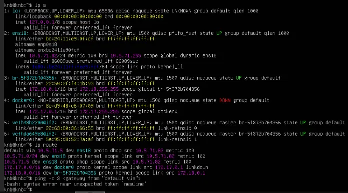
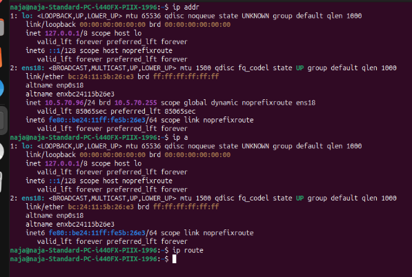
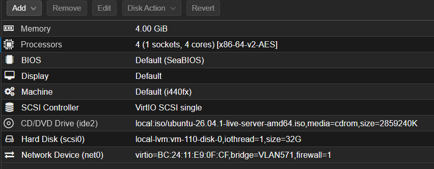
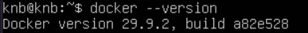

# Kvist & Bjælke ApS


## CDS.Security
### Description of the login platform

The platform is a web application where users log in with a username and password. There are 3 roles. 

**user**: Can read tables

**superuser**: CRUD users

**admin**: CRUD users, superusers, admins

The system consists of an ASP.NET Core (.NET 10) backend, a PostgreSQL database, and a React frontend built with Bun. The backend is divided into API, Service, and Infrastructure layers to keep the application organised.

ASP.NET Core was chosen because it is the framework used in the course and provides features such as authentication, role management, and rate limiting. React and Bun were also chosen because they are part of the technologies used during the semester. PostgreSQL was selected as the database because it is free, reliable, and allows us to enforce rules such as unique usernames and predefined user roles.

The application uses linq2db and Npgsql to communicate with the database, while Argon2 is used to securely hash user passwords before they are stored.

### Implementation

When a user logs in, the server makes a JWT with the user id and the role. It is valid for 30 minutes and is stored in a cookie with HttpOnly (JavaScript can't read it), SameSite=Strict (helps against CSRF) and Secure (only sent over HTTPS). A wrong username and a wrong password give the same 401, so you can't tell which one was wrong. The role is checked on the server on every request. Everyone who is logged in can read users, but only superusers and admins can create, update and delete. Users with the role user do not get the other users' roles from the API, so they cannot see who the admins are. This is done in the backend and not only hidden in the frontend, since the data would otherwise still be visible in the network response. A superuser can only change users with the role user, so they can't edit an admin or make someone an admin, and nobody can delete themselves. The database also only allows the three roles.

Passwords are hashed with Argon2id, so only the hash is saved, never the password. We use 64 MiB memory, 3 iterations and 1 thread, which is more than OWASP's minimum. Every password gets its own random salt, and they must be 12-128 characters long. If the username doesn't exist, the server still checks a dummy hash, so the response time doesn't show if the user exists. Logins are also limited to 5 attempts per minute per IP, errors only show a general message, and Swagger is only on in development. The secrets (database connection, JWT key and admin password) are in environment variables or user-secrets, not in git. In Docker they are given as environment variables, like Jwt__Key. The cookie is Secure by default, but our VM uses plain HTTP, so we turn that off there with Jwt__CookieSecure=false.

For hashing we looked at bcrypt, but chose Argon2id because it is memory-hard. We chose JWT over server-side sessions because it is simpler to run in Docker, and a cookie over localStorage because JavaScript can't read an HttpOnly cookie.

### Screenshots

The screenshots below show the dashboard after logging in with each of the three roles. The same list of users is shown in all three, so the difference comes only from the role of the logged-in user. The Edit and Delete buttons appear when the mouse is held over a row the user is allowed to change.


*Logged in as an admin. The admin can add, edit and delete all users, including superusers and other admins, but cannot delete their own account.*


*Logged in as a superuser. The superuser can see the roles and can add, edit and delete users with the role user. Admins and other superusers cannot be changed.*


*Logged in as a user. The user can only read the list of users. The roles are not shown, and there are no buttons to add, edit or delete users.*


**Source Code**

GitHub link: https://github.com/TonyHo03/KnB

### How to run locally

Requirements: Docker Desktop, .NET 10 SDK, Bun and Git Bash (on Windows).

1. Create secrets (only once). Run from the root of the repository:
```bash
cat > .env <<EOF
DB_PASSWORD=$(openssl rand -hex 16)
ADMIN_PASSWORD=$(openssl rand -hex 12)
JWT_KEY=$(openssl rand -base64 48)
EOF

cd server/api
dotnet user-secrets set "ConnectionStrings:Default" "Host=127.0.0.1;Port=5432;Database=knb;Username=knb;Password=$(grep DB_PASSWORD ../../.env | cut -d= -f2)"
dotnet user-secrets set "Jwt:Key" "$(grep JWT_KEY ../../.env | cut -d= -f2-)"
dotnet user-secrets set "Admin:Password" "$(grep ADMIN_PASSWORD ../../.env | cut -d= -f2)"
dotnet user-secrets set "Cors:Origin" "http://localhost:3000"
cd ../..
```
`.env` and user-secrets are not in git. Each developer generates their own values. `.env.example` shows which variables are needed.

2. Start the database:
```bash
docker compose up -d db
```
docker-compose.override.yml exposes the database on 127.0.0.1:5432 so the API can reach it when it runs outside Docker.

3. Start the API (in a new terminal):
```bash
cd server/api
dotnet run
```

4. Start the frontend (in a new terminal):
```bash
cd client
bun install
bun run dev
```
Open http://localhost:3000 and log in with the username admin and the ADMIN_PASSWORD from your .env.

Troubleshooting: If you get password authentication failed, the database was created earlier with another password. Reset it with docker compose down -v and run step 2 again.

## CDS.Infrastructure

### IP addressing plan

VLAN 57N uses 10.5.7N.x. VLAN 572-576 are our own choice. The assignment writes 10.5.71/24 for the servers, and we read that as 10.5.71.0/24. The gateway in VLAN 571 is 10.5.71.5 in the lab, and we use .5 for VLAN 570 as well. The other networks use .1 as a convention.

| VLAN | Name         | Network      | Subnet mask     | Default gateway | Devices                                      | Addressing |
|------|--------------|--------------|-----------------|-----------------|----------------------------------------------|------------|
| 570  | Clients      | 10.5.70.0/24 | 255.255.255.0   | 10.5.70.5       | 15 desktops, 10 laptops, staff wifi          | DHCP       |
| 571  | Servers      | 10.5.71.0/24 | 255.255.255.0   | 10.5.71.5       | 3 servers                                    | static     |
| 572  | VoIP         | 10.5.72.0/26 | 255.255.255.192 | 10.5.72.1       | 12 IP phones                                 | DHCP       |
| 573  | Printers     | 10.5.73.0/28 | 255.255.255.240 | 10.5.73.1       | 3 printers                                   | static     |
| 574  | Surveillance | 10.5.74.0/27 | 255.255.255.224 | 10.5.74.1       | 6 cameras                                    | static     |
| 575  | Guest        | 10.5.75.0/24 | 255.255.255.0   | 10.5.75.1       | Guest phones and laptops, guest wifi         | DHCP       |
| 576  | Management   | 10.5.76.0/27 | 255.255.255.224 | 10.5.76.1       | Switches, router & firewall, 4 access points | static     |


**Servers and printers**

We split the network into separate VLANs so the servers, which run the login platform, are kept away from the clients and the guests, whose devices we can't control. The firewall decides who reaches what and guests only get internet. Cameras and printers are a bit more vulnerable therefore having their own networks in case they were hacked. Phones are separate so calls will not be disturbed by traffic, and management network keeps switches and access points away from normal users. Servers, printers, cameras and network get static address so they always exist at the same place. Clients, guests, and phones use DHCP, since they can change and are numerous. Every network is bigger than needed so they can be expanded upon in the future. 

### Subnetting

|                | Printers (VLAN 573)   | Surveillance (VLAN 574) | Client                 |
|----------------|-----------------------|-------------------------|------------------------|
| Network Address| 10.5.73.0             | 10.5.74.0               | 10.5.70.0              |
| Subnet mask    | /28 = 255.255.255.240 | /27 = 255.255.255.224   | /24 = 255.255.255.0    |
| Usable hosts   | 2^4 - 2 = 14          | 2^5 - 2 = 30            | 2^8 - 2 = 254          |
| Devices today  | 3                     | 6                       | 25 (plus wifi devices) |

3 printers and gateway need 4 addresses. A /29 would be enough, but /28 has 14 so there is room for more printers. /27 for the cameras has 30 so plenty more cameras can be added. Clients /24 was given and allows for more than enough for the PCs, phones and wifi. If a network gets too small, it can be expanded without changing the others. 

### Ubuntu server on VLAN 571

| Parameter | Value                                       |
|---|---------------------------------------------|
| Operating system | Ubuntu Server 26.04.1 LTS                   |
| Virtualization | Proxmox (VM 110, KnB)                       |
| Hostname | knb                                         |
| Network | VLAN 571                                    |
| IP address | 10.5.71.82/24 (assigned by DHCP in the lab) |
| Default gateway | 10.5.71.5                                   |
| Hosting | Docker container                            |
| Chosen TCP port | 8080 for the API and 8081 for the frontend (within 8000-8100) |



*Ubuntu Server 26.04.1 LTS is installed on the server. The hostname is knb.*



*The server has the address 10.5.71.82/24 on ens18, and the default gateway is 10.5.71.5.*



*The network is tagged with VLAN 571*

### Docker and deployment of the platform



*Docker is installed and the version is shown.*


*The platform runs as three containers with Docker Compose: the API on port 8080, the frontend on port 8081 and the PostgreSQL database, which is only reachable from the server itself (127.0.0.1:5432).*

### Client machine on VLAN 570

| Parameter | Value |
|---|---|
| Operating system | Ubuntu Desktop 26.04 LTS |
| Virtualization | Proxmox |
| Hostname | naja-Standard-PC-i440FX-PIIX-1996 |
| Network | Planned: VLAN 570. Used for testing: VLAN 571 (see Challenges and solutions) |
| IP address | 10.5.71.97/24 (assigned by DHCP) |


*The client got 10.5.71.97/24 from DHCP after it was connected to the VLAN571 bridge.*


*The login platform opened in Firefox on the client at http://10.5.71.82:8081. The admin is logged in and can see all users and their roles.*

### Communication between client and login platform
**Explanation of VLANs, routing and firewall**

The servers and employee computers are placed in different VLANs so they are separated from each other. The servers host the login platform and other internal systems, while employees work on the client network. This adds an extra layer of security because a problem on a client computer is less likely to affect the servers.

Since the VLANs use different IP ranges, devices in one VLAN cannot communicate directly with devices in the other. The traffic needs routing, a client sends it to its default gateway, which passes it on to the other network. Any traffic between them has to go through the firewall, which checks whether the connection is allowed. Only the services needed by the clients are accessible, such as the login platform, while other services on the servers remain unavailable. This reduces unnecessary access and makes the network more secure.

**Testing summary**

Server (VLAN 571)

| Requirement | Result                                          |
|---|-------------------------------------------------|
| Ubuntu Server has been installed | Yes, Ubuntu Server 26.04.1 LTS                  |
| The server has the correct IP configuration | Yes, 10.5.71.82/24 on ens18, gateway 10.5.71.5  |
| Docker has been installed and is functioning | Yes, Docker is installed and `hello-world` runs |
| The login platform is running inside a Docker container | Yes, the container is up with port 8080 mapped   |
| The login platform is accessible through the selected port | Yes, it responds on http://10.5.71.82:8081      |

Client (VLAN 570)

| Requirement | Result |
|---|---|
| The client has the correct IP configuration | Partly. The client could not get an address on VLAN 570, so it was tested on VLAN 571 with 10.5.71.97/24 |
| The client can access the login platform on VLAN 571 | Yes, from the same VLAN. Access across VLAN 570 and 571 could not be tested |
| The login platform's functionality can be used from the client machine | Yes, we logged in from the client and the user table works |

### Challenges and solutions
| Problem                              | Cause                                              | Solution                                           |
|--------------------------------------|----------------------------------------------------|----------------------------------------------------|
| The gateway was not .1               | We assumed .1 as the gateway but the lab uses .5   | Checked ip route and changed the plan to 10.5.70.5 |
| The server got its address from DHCP | The lab's VLAN 571 has DHCP, while ours are static | Kept the lab's address and noted it in the report  |
| The API container kept restarting | The database volume was created earlier with another password | Removed the volume with `docker compose down -v` and started again |
| The client got no IP address | Only the VLAN571 and vmbr0 bridges were available in Proxmox, and vmbr0 did not give access to VLAN 570 | Connected the client to VLAN 571 to test the platform in a browser. Routing and firewall between VLAN 570 and 571 could therefore not be tested |


## AI usage disclosure
We first drafted the IP addressing plan and the subnetting ourselves. We then used Claude to review our drafts and suggest improvements, and we compared its output with our own. We adopted the extra VLANs and the static vs DHCP allocation, and kept our own choices for the rest. Claude also helped with the structure of the README, draft explanations of VLANs, routing, and the firewall, which we then adjusted ourselves. Claude was also used as help with the login platform: code optimization, and specifics such as JWT tokens, password hashing with argon2id, and the login system with the three roles. We reviewed and adapted the suggestions before using them. The virtual machines, Docker setup, configuration, testing, and screenshots were done by us. We take responsibility for the whole report.


## Final reflection
Security and infrastructure depend on each other. The login platform has strong password hashing and role checks, but that doesn't help much if anyone on the network can reach the servers. So the servers are in their own VLAN, and the firewall only lets the clients reach the login platform on certain ports. It also goes the other way. The cookie is only sent over HTTPS when it is set to Secure, and our VM uses plain HTTP, so we had to turn that setting off.

The main challenges were the differences between our plan and the lab. We planned .1 as the gateway, but the lab uses .5, and the server got its address from DHCP even though we planned static addresses for servers. We also could not connect the client to VLAN 570, because the bridge for it was not available to us in Proxmox, so the client was tested from VLAN 571 instead. We learned that an application is more than the code. It also needs a database, settings, a port and a path through the network, and Docker Compose lets us start everything the same way each time.

In a real company we would use HTTPS, so the cookie can stay Secure, and find a way to cancel a JWT before it expires. Right now a deleted user can stay logged in for up to 30 minutes. We would also keep the secrets somewhere safer and make backups of the database.
